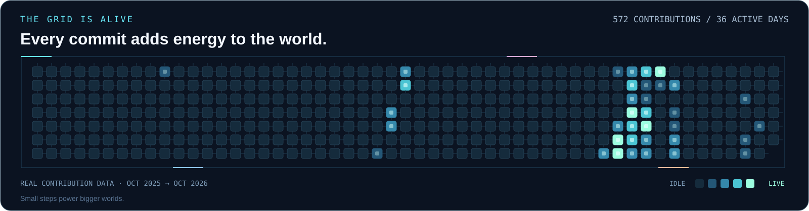
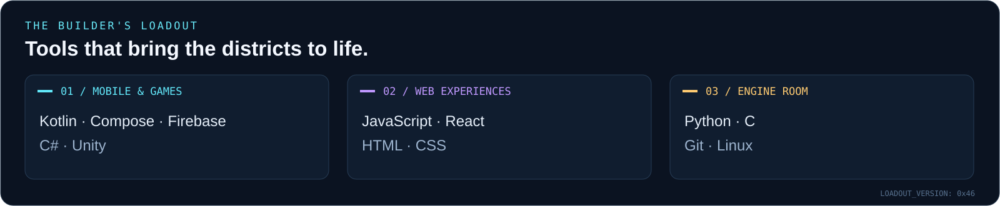

<p align="center">
  
</p>

<p align="center">
  <strong>MSc student in Computer Engineering</strong><br />
  Istanbul University-Cerrahpaşa<br /><br />
  I turn ideas into Android apps, playable worlds and useful tools.
</p>

<p align="center">
  <a href="https://www.linkedin.com/in/hasan-furkan-duzman-9a0a3524b/">LinkedIn ↗</a>
  &nbsp; · &nbsp;
  <a href="mailto:furkanduzman46@gmail.com">Send a signal ↗</a>
  &nbsp; · &nbsp;
  <a href="https://github.com/Duzman46?tab=repositories">All experiments ↗</a>
</p>


### Explore the districts

Four projects. Four corners of the same world. Pick a district to see its code.

<table>
  <tr>
    <td width="50%"><a href="https://github.com/Duzman46/koridor"></a></td>
    <td width="50%"><a href="https://github.com/Duzman46/EmirTronGame"></a></td>
  </tr>
  <tr>
    <td width="50%"><a href="https://github.com/Duzman46/hali-saha-yonetim"></a></td>
    <td width="50%"><a href="https://github.com/Duzman46/Secret-Notes"></a></td>
  </tr>
</table>

<br />



<br />



<br />

<details>
  <summary><strong>⌘ Inspect the blueprint — a few things hidden in this world</strong></summary>

  <br />

  - **The strategy district:** Koridor explores pathfinding and game AI through BFS, A* and minimax, with Firebase multiplayer connecting the players.
  - **The neon district:** EmirTron turns C# and Unity into a time-travelling cyberpunk adventure.
  - **The connected district:** React, Vite and Ant Design power pitch reservations and customer management.
  - **The mechanical district:** Secret Notes is a small Python/Tkinter experiment in saving and decoding notes with a key.
  - **The living grid:** each chip represents a real day in my public contribution calendar. Its brightness follows GitHub's activity level; a daily workflow refreshes the world.
  - **0x46:** a small signature hiding in the circuits. Some details only show up when you take another look.

  ```python
  while curious:
      learn()
      build()
      repeat()
  ```

</details>


<p align="center">
  <sub>Beyond the map: <a href="https://github.com/Duzman46/python_homework">Python practice</a> · <a href="https://github.com/Duzman46/hava-durumu">Android weather</a> · <a href="https://github.com/Duzman46/Weather-App">Python weather</a></sub><br />
  <sub>Keep exploring. There is always another world to build.</sub>
</p>
